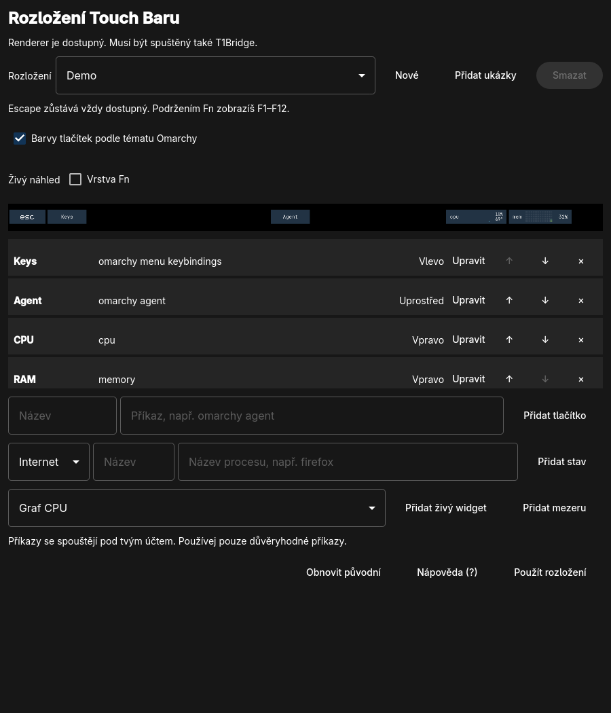

# Omarchy na MacBooku Pro 13" 2017 (Touch Bar)

Poznámky, skripty a editor Touch Baru pro **MacBookPro14,2 (A1706, 13" 2017,
Touch Bar, čip T1)** s [Omarchy](https://omarchy.org). Cílem je bezpečný a
opakovatelný postup po instalaci: česká klávesnice, hardware, Touch Bar
s vlastními scénami.

> **English summary:** Notes, post-install scripts and a Touch Bar scene editor
> (`tbar`) for running Omarchy on a MacBookPro14,2 (13" 2017, T1). Documentation
> is in Czech. Verified on a single machine only; other models are untested.
> Back up the Apple EFI partition before installing Linux.

Projekt je **experimentální** a ověřený na jediném počítači. Není to kompletní
automatický instalátor a jiné modely MacBooku mohou vyžadovat jiné ovladače.

## Stav na testovaném stroji

Naposledy zkontrolováno 2026-11-20: Omarchy 4.5.0, jádro `7.2.15-1-omarchy`,
T1Bridge 0.1.12. Podrobnosti, známé potíže a workaroundy jsou
v [docs/HARDWARE.md](docs/HARDWARE.md).

| Součást | Stav | Poznámka |
| --- | --- | --- |
| Klávesnice a touchpad | funguje | vestavěný `applespi` |
| České QWERTZ | funguje | jen grafická relace; německý potisk zůstává |
| Wi-Fi (BCM43602) | funguje | `brcmfmac`; 5 GHz neověřeno |
| Reproduktory a mikrofon | funguje | zvukový modul je mimo správu balíčků |
| Touch Bar, Esc, dotyk | funguje | T1Bridge + `omarchy-glance`, ověřeno i po restartu |
| Vlastní scény Touch Baru | funguje | editor [tbar](tbar/README.md); část funkcí experimentální |
| USB zařízení | funguje s workaroundem | volitelná služba, viz [USB](docs/HARDWARE.md#usb-zařízení-se-po-odpojení-znovu-neobjeví) |
| Uspání a probuzení | známý problém | T1Bridge ho nepodporuje; nezkoušeno |
| Kamera, Bluetooth, sluchátka, externí monitor | neověřeno | |
| Touch ID | neověřeno | nebylo nastaveno |

„Funguje“ znamená potvrzeno na tomto jednom stroji s uvedenými verzemi.
Po aktualizaci jádra se stav může změnit.

## Než začneš

- **Zálohuj Apple EFI oddíl** na jiné médium, včetně `EFI/APPLE/EMBEDDEDOS`
  a souboru `FDRData`. Je specifický pro daný počítač: **nikdy ho
  nezveřejňuj**. Jeho smazání může vyřadit Touch Bar a kameru.
- Apple EFI oddíl nepřeformátovávej. Postup zálohy popisuje
  [ArchWiki pro MacBookPro14,2](https://wiki.archlinux.org/title/MacBookPro14,2).
- Před změnami ovladačů nebo bootování si připrav obnovovací USB, zálohu dat
  a heslo, které umíš napsat i na přihlašovací obrazovce.

## Rychlý postup

```bash
git clone https://github.com/KubMakCZ/omarchy-macbook-pro-2017-utilities.git
cd omarchy-macbook-pro-2017-utilities
bash setup.sh --check
```

`--check` pouze čte stav a nic nemění. Další kroky lze spouštět jednotlivě
a opakovaně:

| Příkaz | Co udělá | Mění systém? |
| --- | --- | --- |
| `bash setup.sh --check` | diagnostika modelu, ovladačů, služeb a nástrojů | ne |
| `bash setup.sh --keyboard` | české QWERTZ pro aktuálního uživatele | uživatelská konfigurace, se zálohou |
| `bash setup.sh --usb-power` | volitelná oprava USB řadičů | systémová služba, `sudo` |
| `bash setup.sh --renderer-build` | sestaví a nainstaluje renderer `omarchy-glance` | `~/.local/bin`, bez aktivace |
| `bash setup.sh --renderer-enable` | aktivuje renderer po instalaci T1Bridge | uživatelské služby, restart Touch Baru |
| `bash setup.sh --build-app` | sestaví editor `tbar` | ne |
| `bash setup.sh --install-app` | sestaví a nainstaluje balíček `tbar` | balíčky, může žádat heslo |

Žádný krok neformátuje disky ani nepřepíná T1 ovladače a odlišné existující
soubory se nepřepisují. **T1Bridge se zatím instaluje ručně** podle
[docs/INSTALL.md](docs/INSTALL.md); celý postup na čistém systému ještě nebyl
zopakován.

## Dokumentace

| Soubor | Obsah |
| --- | --- |
| [docs/INSTALL.md](docs/INSTALL.md) | postup od čistého Omarchy po vlastní Touch Bar |
| [docs/HARDWARE.md](docs/HARDWARE.md) | stav hardwaru, známé potíže, USB workaround, starý ovladač |
| [TIPY.md](TIPY.md) | klávesnice, zkratky a každodenní používání |
| [tbar/README.md](tbar/README.md) | editor scén Touch Baru, formát JSON a CLI |
| [ROADMAP.md](ROADMAP.md) | hotové věci, plány a nápady |
| [docs/T1BRIDGE-PLAN.md](docs/T1BRIDGE-PLAN.md) | historický deník přechodu na T1Bridge |
| [CONTRIBUTING.md](CONTRIBUTING.md) | jak nahlásit zkušenost z jiného stroje a jak přispět |
| [AGENTS.md](AGENTS.md) | pokyny pro AI agenty pracující v repozitáři |

## Touch Bar ve zkratce

Panel obsluhuje [T1Bridge](https://github.com/standardagents/t1bridge)
a renderer [omarchy-glance](https://github.com/andersryanc/omarchy-macbook-touchbar-custom).
Editor `tbar` z tohoto repozitáře vytváří scény s vlastními tlačítky, stavy
a grafy:



Když panel nesvítí, začni tady:

```bash
systemctl --user status t1-touchbar.service --no-pager
```

```bash
sudo t1bridge status
```

Stará služba `omarchy-mbp-touchbar.service` a `tiny-dfr` **nesmějí běžet
společně s T1Bridge**; viz [docs/HARDWARE.md](docs/HARDWARE.md#touch-bar).

## Licence a příspěvky

Licence vlastního kódu zatím nebyla zvolena; do té doby není uděleno oprávnění
k dalšímu šíření a před přijímáním příspěvků ji bude nutné určit. Cizí projekty
(T1Bridge, omarchy-glance, Omarchy) mají vlastní licence a nejsou součástí
tohoto repozitáře. Zkušenosti z jiných strojů jsou vítané, viz
[CONTRIBUTING.md](CONTRIBUTING.md).
