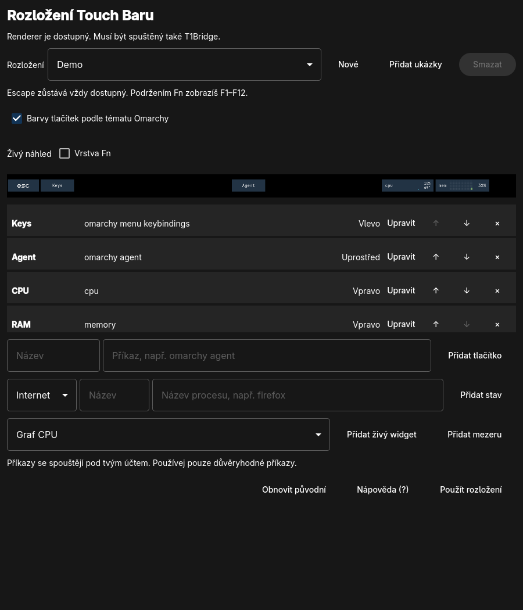
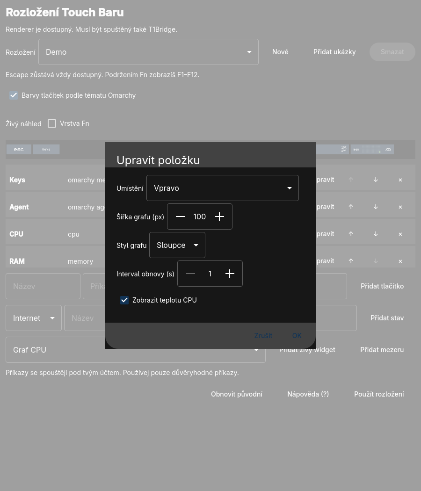

# tbar: experimentální editor scén



Qt aplikace pro přípravu vlastních rozložení Touch Baru na Omarchy. Základní
scéna a tlačítka byly ověřeny na MacBookPro14,2; další widgety jsou experimentální.
Samotná aplikace neinstaluje ovladač, T1Bridge ani
[omarchy-glance](https://github.com/andersryanc/omarchy-macbook-touchbar-custom);
ty popisuje [instalace](../docs/INSTALL.md). Starší firmwareový režim bez
vlastního rendereru její vlastní tlačítka nepodporuje.

Obsah: [příprava](#příprava-a-spuštění) · [použití](#použití) ·
[formát scény](#formát-scény-json) · [náhled a zálohy](#náhled-zálohy-a-obnovení) ·
[CLI](#cli-pro-lidi-a-ai-nástroje) · [omezení](#omezení-a-další-vývoj)

## Příprava a spuštění

Z adresáře `tbar`:

```bash
bash bin/build
./build/tbar
```

Je potřeba qmake6, make, C++ kompilátor a Qt 6 včetně Qt Quick Controls.
Pro případnou lokální instalaci do nabídky aplikací je připravený Arch balíček:
`bash bin/install` zavolá `makepkg -fsi` a může požádat o instalaci závislostí
a heslo. Nainstaluje také hook `tbar-theme-sync` pro změnu tématu, pokud ještě
neexistuje. Při instalaci samotného balíčku jej lze přidat příkazem
`omarchy hook install theme-set /usr/share/tbar/tbar-theme-sync`; před spuštěním
zkontroluj, že stejnojmenný hook ještě neexistuje (příkaz jej přepisuje).

Editor je pod [licencí MIT](../LICENSE); balíček ji instaluje do
`/usr/share/licenses/tbar/`.

## Použití

Vyber nebo vytvoř scénu, přidej příkazy či stavy a případně změň jejich
pořadí. Každá scéna podporuje nejvýše 12 položek. „Použít rozložení“ zapíše
nastavení pro renderer; samotný výběr scény ji na Touch Bar neaplikuje. Na
horní vrstvě exportu je přidané `Esc`, na vrstvě Fn `Esc` a F1–F12; jejich
skutečné fungování závisí na ovladači, rendereru a hardwaru.

### Příkazy a stavy

Příkaz může být například `omarchy menu keybindings`,
`omarchy menu toggle appearance.theme`, `omarchy agent` nebo
`omarchy system lock`. `omarchy agent` otevře výchozího agenta Omarchy,
kterým nemusí být na jiném počítači Copilot. Příkazy se spouštějí pod tvým
účtem v `/bin/sh`: přidávej jen ty, kterým důvěřuješ.

Stav internetu potřebuje NetworkManager a `nmcli`, teplota čte senzor
`coretemp` a stav aplikace používá `pgrep -x` a přesný název procesu
(nejvýše 15 znaků). Neznámý stav se zobrazuje jako `?`. Stavové texty se
mohou zobrazovat i při zamčené obrazovce. Spouštění příkazů se pokouší
zamčení ověřit dvěma dotazy a při chybě příkaz odmítá, ale mezi kontrolou
a spuštěním existuje časové okno: **nejde o bezpečnostní záruku**.

### Ukázkové scény a grafy

„Přidat ukázky“ vytvoří chybějící scény `Work`, `Monitor` a `IT Demo`, aniž
by přepsalo existující scény se stejným názvem nebo změnilo aktuální výběr.
`Work` nabízí zkratky a baterii, `Monitor` živé grafy CPU, RAM, sítě a disku
a stav baterie. `IT Demo` kombinuje zkratky s grafy CPU, RAM, sítě a baterií.
Živé widgety lze přidávat také jednotlivě. Grafy reagují na skutečnou zátěž;
dostupnost údajů závisí na hardwaru a rendereru.

### Ovládání hlasitosti, jasu a médií

„Přidat ovládání“ vloží hotovou skupinu tlačítek: hlasitost (ztlumit, −, +),
jas displeje (−, +), podsvícení klávesnice (−, +), přehrávač médií nebo
mikrofon. Tlačítka − a + se při podržení opakují. **Posuvník jako v macOS
renderer neumí**; jde o tlačítka. Skupina se počítá jako jedna položka scény,
i když na panelu zabere dvě až čtyři tlačítka; šířka platí pro každé z nich.
Tato tlačítka volají příkazy Omarchy přímo z rendereru, takže fungují i při
zamčené obrazovce.

### Přepínání scén na Touch Baru

„Přidat přepínač rozložení“ vloží tlačítko, které přepne na vybranou scénu
nebo na další scénu v pořadí. Totéž udělá `tbar next`, který lze dát na
klávesovou zkratku. Přepínání funguje až poté, co jednu scénu použiješ
tlačítkem „Použít rozložení“; nevytváří další zálohy a odmítne běžet, pokud
konfiguraci rendereru mezitím změnil někdo jiný. `Esc` je v každé scéně, ale
**tlačítko pro návrat si do cílové scény přidej sám**, jinak se zpět dostaneš
jen z editoru nebo příkazem `tbar next`.

### Automatická scéna podle aplikace

Do pole „Zobrazit pro aplikace“ napiš třídy oken oddělené čárkou, například
`firefox, code`. Třídu aktivního okna vypíše `hyprctl activewindow`. Když
běží služba, scéna se použije po přepnutí do dané aplikace a po odchodu se
vrátí scéna, kterou jsi naposledy zvolil ručně:

```bash
systemctl --user enable --now tbar-watch.service
```

Vypnutí: `systemctl --user disable --now tbar-watch.service`. Služba reaguje
jen na změnu aplikace, takže ručně přepnutá scéna vydrží, dokud nepřejdeš
jinam. Vyžaduje Hyprland.

Tlačítka scény mohou posílat klávesové zkratky aktivnímu oknu pomocí `wtype`,
například `wtype -M ctrl t -m ctrl` pro nový panel prohlížeče nebo
`wtype -M alt -k Left -m alt` pro krok zpět.

### Umístění a šířky

U položky klikni na „Upravit“ a vyber levou, střední nebo pravou část a šířku;
u grafů navíc styl teček či sloupců, interval a u CPU teplotu. „Přidat mezeru“
vloží prázdné místo s nastavitelnou šířkou. Escape zůstává vlevo. Renderer
umisťuje každou část nezávisle: pokud jsou příliš široké, mohou se překrýt;
zkontroluj výsledek v náhledu. Skutečné CSS `space-between`, `space-around`
a `space-evenly` renderer nepodporuje.



### Barvy podle tématu

Nabídka „Barvy“ platí pro celou vybranou scénu včetně Esc; „Použít pro
všechna rozložení“ nastaví stejný styl všem scénám. Styly berou barvy
z aktuálního tématu Omarchy, i vlastního:

| Styl (`theme`) | Lišta | Tlačítka | Text |
| --- | --- | --- | --- |
| vynecháno | černá | šedá | bílý |
| `auto` | černá | `lighter_background` | `foreground` |
| `tinted` | `background` | `selection` | `foreground` |
| `accent`, `magenta`, `blue`, `cyan`, `green`, `yellow`, `orange`, `red` | `darker_background` | zvolená barva tématu | `darker_background` |

Po použití scény hook při změně tématu bezpečně
aktualizuje barvy; nezasáhne do konfigurace změněné mimo editor.

„Vlastní barva“ nastaví tlačítkům pevnou barvu `#rrggbb` (například fialová
`#cba6f7`) na černé liště; text je černý nebo bílý podle jasu barvy. Pevná
barva se s tématem nemění.

### Escape, ikony, písmo a ztlumení

Řádek „Escape“ změní vzhled celé scény: vlastní text nebo ikonu klávesy Esc
(dál posílá Escape), písmo lišty a dobu nečinnosti, po které lišta ztmavne na
čtvrtinu jasu (0 = nikdy). U tlačítka a přepínače rozložení jde v „Upravit“
zadat „Ikona místo textu“. Ikona je jeden znak z Nerd Fontu; znak zkopíruj
z přehledu na [nerdfonts.com/cheat-sheet](https://www.nerdfonts.com/cheat-sheet).
Obrázky PNG, různé barvy jednotlivých tlačítek a animace renderer neumí. Grafy používají
výchozí barvy tématu btop, které renderer průběžně sleduje. Automatická změna
barev tlačítek vyžaduje nainstalovaný hook, není vázaná na otevřený editor.

### Předvedení a klávesové zkratky

Pro ukázku v IT komunitě vyber `IT Demo`, potvrď „Použít rozložení“ a ukaž,
jak se při práci mění grafy. Tlačítko `Keys` otevře přehled zkratek; výběr
jiné scény v editoru a její použití ukáže přizpůsobení. Než začneš nahrávat
nebo sdílet obrazovku, zkontroluj, zda neobsahuje osobní údaje.

| Zkratka | Akce |
| --- | --- |
| `?` | Nápověda |
| `Ctrl + Enter` | Potvrzení použití scény |
| `Esc` | Zavření dialogu |

## Formát scény (JSON)

Scény jsou v `~/.config/tbar/profiles.json` (respektuje se `XDG_CONFIG_HOME`).
Před ručními úpravami soubor zálohuj a zavři editor; příkazy z neznámých
zdrojů nespouštěj bez kontroly. Bezpečnější než ruční úprava je
[CLI](#cli-pro-lidi-a-ai-nástroje): `tbar validate` a `tbar import`.
Příklad položek scény (vynechaná `section` znamená `left`):

```json
{
  "name": "Demo",
  "theme": "auto",
  "buttons": [
    { "label": "Keys", "command": "omarchy menu keybindings", "section": "left", "width": 150 },
    { "kind": "spacer", "label": "Spacer", "command": "", "section": "center", "width": 40 },
    { "kind": "widget", "label": "CPU", "command": "cpu", "section": "right", "width": 100,
      "style": "bars", "interval": 1, "temperature": true }
  ]
}
```

Úplný soubor obsahuje `version`, `selected` a pole `profiles`. Scéna má
nejvýše 12 položek; výchozí `Esc` a vrstvu Fn doplňuje editor. Přesnou
definici vypíše `tbar schema --json`.

| `kind` | Význam | `command` |
| --- | --- | --- |
| vynecháno nebo `button` | tlačítko | shellový příkaz |
| `widget` | živý graf | `cpu`, `memory`, `network`, `disk` nebo `battery` |
| `internet` | stav připojení | nepoužívá se |
| `temperature` | teplota ze senzoru `coretemp` | nepoužívá se |
| `process` | stav aplikace | přesný název procesu (1–15 znaků: písmena, číslice, `.`, `_`, `+`, `-`) |
| `spacer` | prázdné místo | prázdný |
| `control` | skupina ovládacích tlačítek | `volume`, `brightness`, `keyboard`, `media` nebo `mic` |
| `scene` | přepnutí na scénu | název cílové scény |
| `scene-next` | přepnutí na další scénu | nepoužívá se |

Scéna může mít pole `apps`: nejvýše 8 tříd oken (písmena, číslice, `.`, `_`,
`+`, `-`), pro které se použije automaticky; velikost písmen nerozhoduje.

Další pole položky:

- `label`: popisek, nejvýše 16 znaků.
- `section`: `left` (výchozí), `center` nebo `right`.
- `width`: 10–500 px; u grafu jde o šířku samotného grafu, ne celé položky.
- `style`: `dots` nebo `bars`, jen pro grafy.
- `interval`: 1–60 sekund, jen pro grafy.
- `temperature`: `true` nebo `false`, jen pro graf `cpu`.
- `icon`: jeden znak (nejvýše 4 kódové jednotky) místo textu, jen pro
  `button`, `scene` a `scene-next`.

Další pole scény: `theme` (styl z tabulky výše nebo `#rrggbb`), `escLabel`
(1–16 znaků), `escIcon` (jeden znak, má přednost), `font` (název rodiny písma)
a `idleDim` (0–3600 sekund).

## Náhled, zálohy a obnovení

Živý náhled zobrazuje vybranou scénu i volitelnou vrstvu Fn bez jejího použití.
Obnovuje se přibližně po pěti sekundách pomocí `omarchy-glance preview`: údaje
jsou skutečné, ale historie grafů je krátká, protože se každý snímek vzorkuje
znovu. Stavové příkazy se při náhledu spouštějí; tlačítka náhledu nejsou aktivní.
V menším okně lze obsahem editoru posouvat; při úzkém okně i vodorovně.

Při prvním použití editor zaznamená původní konfiguraci rendereru v
`~/.config/tbar/original-renderer.json` a před každým přepsáním existujícího
`~/.config/omarchy-glance/touchbar.json` vytvoří další zálohu vedle něj.
„Obnovit původní“ vrací stav před prvním použitím a odmítne přepsat změny
provedené mezitím mimo aplikaci. Zálohy nemaž, dokud je nepotřebuješ.

Export obsahuje absolutní cestu ke spuštěnému `tbar`; po přesunu aplikace
nebo instalaci balíčku je nutné scénu znovu použít.

## CLI pro lidi a AI nástroje

CLI funguje bez displeje. Výsledky vypisuje jako JSON na standardní výstup;
s `--json` jsou chyby (kromě původního `check`) JSON na chybovém výstupu.
Úspěch vrací kód 0, chyba nenulový. `FILE` obsahuje jednu scénu jako v příkladu
výše, nikoli celý `profiles.json`; `-` čte standardní vstup. Validace ani
import příkazy ve scéně nespouští.

```bash
tbar list --json                  # seznam a aktuálně vybraná scéna
tbar show "Demo" --json           # jediná scéna pro další úpravy
tbar schema --json                # JSON Schema pro import
tbar validate scena.json --json   # kontrola bez zápisu
tbar import scena.json --json     # přidání, bez výběru a použití
tbar import scena.json --replace --json  # nahrazení existující scény se zálohou
tbar select "Demo" --json         # změní výběr, ale ne Touch Bar
tbar export "Demo" --json         # renderer JSON bez použití
tbar apply "Demo" --json          # použije na Touch Baru, nezmění výběr
tbar next --json                  # přepne Touch Bar na další scénu
tbar watch                        # sleduje aktivní okno (běží jako služba)
tbar restore --json               # bezpečné obnovení původního nastavení
tbar skill install --json         # volitelný návod pro agenty, nepřepisuje existující
tbar help
```

Příkaz `export` bez názvu zachovává původní chování a exportuje vybranou scénu;
`check` nadále poskytuje původní přehled. Přepsání scény vyžaduje `--replace`
a uloží zálohu `profiles.json.backup-*`. `apply` vytváří zálohy rendereru
stejně jako grafické rozhraní. Scény mohou obsahovat **libovolné shellové
příkazy**: před importem a použitím je vždy zkontroluj. Instalace agentního
skill souboru je volitelná a probíhá až na výslovný příkaz do
`~/.agents/skills/tbar/SKILL.md`.

Nová verze editoru při souběžných úpravách detekuje změněný `profiles.json`
a odmítne jej přepsat nebo použít zastaralou scénu. V takovém případě editor
zavři a znovu otevři. Starší verze tuto ochranu nemají: před aktualizací
a souběžným použitím CLI je zavři. Ruční zápisy jiných programů nejsou tímto
zámkem koordinovány, proto při úpravách souboru editor i CLI zavři.

Lokálně sestavený program lze místo `tbar` spustit jako `./build/tbar`;
testy spouští `bash bin/test` po sestavení. Export základní scény byl ověřen
s `omarchy-glance` revize `9c75e5e1d71cf583fe9b02c124cffa272fd7fcb1` na
MacBookPro14,2. Renderer je samostatný projekt pod svou licencí.

## Omezení a další vývoj

Na MacBookPro14,2 T1Bridge uvádí omezení uspávání/probuzení. Přechod vyžaduje
kontrolu kompatibility, zálohu Apple EFI, plán návratu, možnou aktualizaci
jádra a restart. **Nepřepínej konkurenční ovladače za běhu.** Na testovaném
stroji Touch Bar používá T1Bridge DKMS; při původní kontrole byl zvukový modul
mimo správu balíčků. Aktualizace může funkce rozbít. Návod na
[instalaci stacku](../docs/INSTALL.md) není zatím ověřen na čistém systému.

Ovládací tlačítka (hlasitost, jas, podsvícení klávesnice, média) a tlačítko
další scény uživatel potvrdil na panelu MacBookPro14,2 dne 2026-11-21
(`tbar 0.1.0-8`). Automatika podle aplikace na témže stroji přepnula scénu
při přechodu do Firefoxu a zpět a uživatel potvrdil tlačítka scény se
zkratkami přes `wtype`. Chování po restartu ověřeno není; tlačítko mikrofonu
prošlo jen testy. Posuvníky, GIFy, libovolný počet prvků a vlastní grafické ikony
nejsou implementovány.
Budoucí úpravy OpenCore jsou samostatný úkol; tento projekt bootloader nemění.
