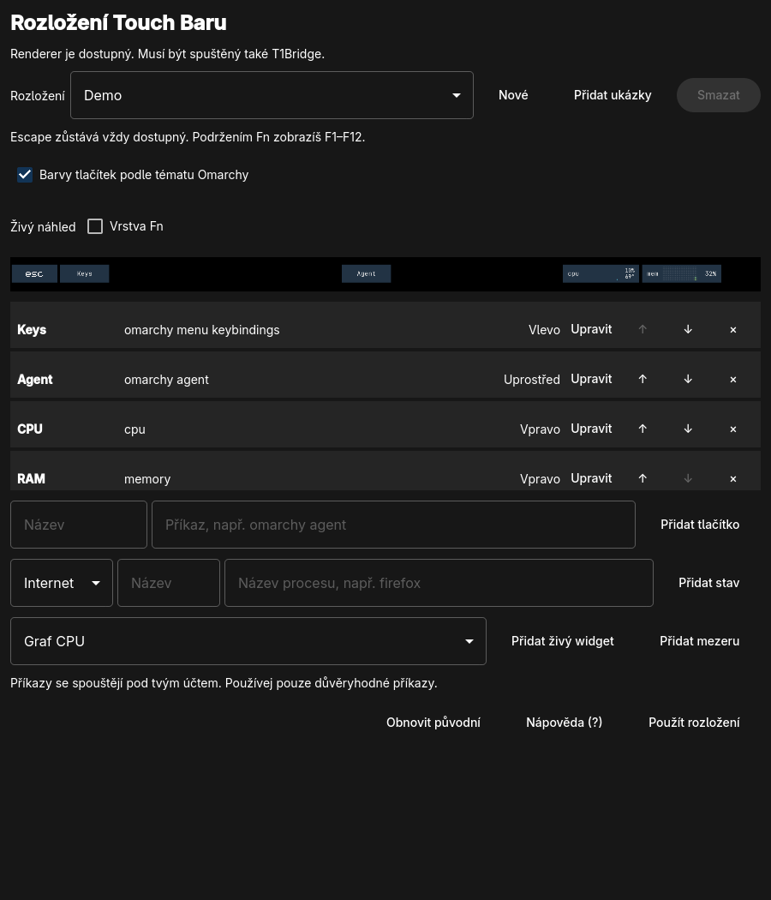
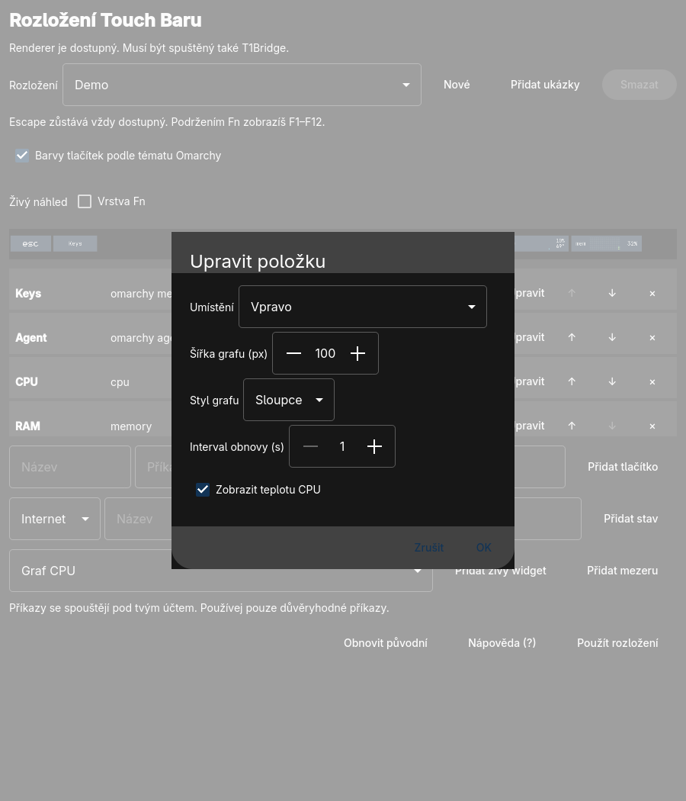

# tbar: experimentální editor scén



Qt aplikace pro přípravu vlastních rozložení Touch Baru na Omarchy. Základní
scéna a tlačítka byly ověřeny na MacBookPro14,2; další widgety jsou experimentální.
Samotná aplikace
neinstaluje ovladač, T1Bridge ani [omarchy-glance](https://github.com/andersryanc/omarchy-macbook-touchbar-custom).
Současný firmwareový režim nepodporuje její vlastní tlačítka.

## Příprava a spuštění

Z adresáře `tbar`:

```bash
bash bin/build
./build/tbar
```

Je potřeba qmake6, make, C++ kompilátor a Qt 6 včetně Qt Quick Controls.
Pro případnou lokální instalaci do nabídky aplikací je připravený Arch balíček:
`bash bin/install` zavolá `makepkg -si` a může požádat o instalaci závislostí
a heslo. Nainstaluje také hook `tbar-theme-sync` pro změnu tématu, pokud ještě
neexistuje. Při instalaci samotného balíčku jej lze přidat příkazem
`omarchy hook install theme-set /usr/share/tbar/tbar-theme-sync`; před spuštěním
zkontroluj, že stejnojmenný hook ještě neexistuje (příkaz jej přepisuje).
Projektová licence
dosud nebyla zvolena; balíček označuje vlastní kód jako nelicencovaný a není
tím uděleno oprávnění k dalšímu šíření.

## Použití

Vyber nebo vytvoř scénu, přidej příkazy či stavy a případně změň jejich
pořadí. Každá scéna podporuje nejvýše 12 položek. „Použít rozložení“ zapíše
nastavení pro renderer; samotný výběr scény ji na Touch Bar neaplikuje. Na
horní vrstvě exportu je přidané `Esc`, na vrstvě Fn `Esc` a F1–F12; jejich
skutečné fungování závisí na ovladači, rendereru a hardwaru.

Příkaz může být například `omarchy menu keybindings`,
`omarchy menu toggle appearance.theme`, `omarchy agent` nebo
`omarchy system lock`. `omarchy agent` otevře výchozího agenta Omarchy,
kterým nemusí být na jiném počítači Copilot. Příkazy se spouštějí pod tvým
účtem v `/bin/sh`: přidávej jen ty, kterým důvěřuješ.

Stav internetu potřebuje NetworkManager a `nmcli`, teplota čte senzor
`coretemp` a stav aplikace používá `pgrep -x` a přesný název procesu
(nejvýše 15 znaků). Neznámý stav se zobrazuje jako `?`. Stavové texty se
mohou zobrazovat i při zamčené obrazovce. Spouštění příkazů se pokouší
zamčení ověřit dvěma dotazy a při chybě příkaz odmítá, ale mezi kontrolou
a spuštěním existuje časové okno: **nejde o bezpečnostní záruku**.

„Přidat ukázky“ vytvoří chybějící scény `Work`, `Monitor` a `IT Demo`, aniž
by přepsalo existující scény se stejným názvem nebo změnilo aktuální výběr.
`Work` nabízí zkratky a baterii, `Monitor` živé grafy CPU, RAM, sítě a disku
a stav baterie. `IT Demo` kombinuje zkratky s grafy CPU, RAM, sítě a baterií.
Živé widgety lze přidávat také jednotlivě. Grafy reagují na skutečnou zátěž;
dostupnost údajů závisí na hardwaru a rendereru.

U položky klikni na „Upravit“ a vyber levou, střední nebo pravou část a šířku;
u grafů navíc styl teček či sloupců, interval a u CPU teplotu. „Přidat mezeru“
vloží prázdné místo s nastavitelnou šířkou. Escape zůstává vlevo. Renderer
umisťuje každou část nezávisle: pokud jsou příliš široké, mohou se překrýt;
zkontroluj výsledek v náhledu. Skutečné CSS `space-between`, `space-around`
a `space-evenly` renderer nepodporuje.



Volba „Barvy tlačítek podle tématu Omarchy“ platí pro celou vybranou scénu
včetně Esc a dalších tlačítek. Po použití scény hook při změně tématu bezpečně
aktualizuje barvy; nezasáhne do konfigurace změněné mimo editor. Grafy používají
výchozí barvy tématu btop, které renderer průběžně sleduje. Automatická změna
barev tlačítek vyžaduje nainstalovaný hook, není vázaná na otevřený editor.

Pro ukázku v IT komunitě vyber `IT Demo`, potvrď „Použít rozložení“ a ukaž,
jak se při práci mění grafy. Tlačítko `Keys` otevře přehled zkratek; výběr
jiné scény v editoru a její použití ukáže přizpůsobení. Než začneš nahrávat
nebo sdílet obrazovku, zkontroluj, zda neobsahuje osobní údaje.

| Zkratka | Akce |
| --- | --- |
| `?` | Nápověda |
| `Ctrl + Enter` | Potvrzení použití scény |
| `Esc` | Zavření dialogu |

Scény jsou v `~/.config/tbar/profiles.json` (respektuje se `XDG_CONFIG_HOME`).
Soubor je JSON a lze jej číst například pomocí AI. Před ručními úpravami jej
zálohuj a zavři editor; příkazy z neznámých zdrojů nespouštěj bez kontroly.
Příklad položek scény (vynechaná `section` znamená `left`):

```json
{
  "name": "Demo",
  "theme": "auto",
  "buttons": [
    { "label": "Keys", "command": "omarchy menu keybindings", "section": "left", "width": 150 },
    { "kind": "spacer", "label": "Spacer", "command": "", "section": "center", "width": 40 },
    { "kind": "widget", "label": "CPU", "command": "cpu", "section": "right", "width": 100,
      "style": "bars", "interval": 1, "temperature": true }
  ]
}
```

`width` u grafu znamená šířku samotného grafu, ne celé položky. Dostupné
hodnoty `section` jsou `left`, `center`, `right`; `style` je `dots` nebo
`bars`. Úplný soubor obsahuje `version`, `selected` a pole `profiles`.
Položky bez `kind` jsou tlačítka se shellovým příkazem v `command`. Pro
`kind: "widget"` je `command` jeden z `cpu`, `memory`, `network`, `disk`,
`battery`; `width` je 10–500 px a `interval` 1–60 sekund. Teplotu podporuje
CPU. `kind: "spacer"` má šířku v `width`. Stavové položky mají `kind`
`internet`, `temperature` nebo `process`; u posledního je v `command` přesný
název procesu (1–15 znaků: písmena, číslice, `.`, `_`, `+`, `-`).
Scéna obsahuje nejvýše 12 položek; výchozí `Esc` a vrstvu Fn doplňuje editor.
Živý náhled zobrazuje vybranou scénu i volitelnou vrstvu Fn bez jejího použití.
Obnovuje se přibližně po pěti sekundách pomocí `omarchy-glance preview`: údaje
jsou skutečné, ale historie grafů je krátká, protože se každý snímek vzorkuje
znovu. Stavové příkazy se při náhledu spouštějí; tlačítka náhledu nejsou aktivní.
V menším okně lze obsahem editoru posouvat; při úzkém okně i vodorovně.
Při prvním použití editor zaznamená původní konfiguraci rendereru v
`~/.config/tbar/original-renderer.json` a před každým přepsáním existujícího
`~/.config/omarchy-glance/touchbar.json` vytvoří další zálohu vedle něj.
„Obnovit původní“ vrací stav před prvním použitím a odmítne přepsat změny
provedené mezitím mimo aplikaci. Zálohy nemaž, dokud je nepotřebuješ.
Export obsahuje absolutní cestu ke spuštěnému `tbar`; po přesunu aplikace
nebo instalaci balíčku je nutné scénu znovu použít.

Pro kontrolu bez grafického prostředí:

```bash
./build/tbar check
./build/tbar export
bash bin/test
```

`export` vypíše JSON, ale nezapíše konfiguraci. Export základní scény byl ověřen
s `omarchy-glance` revize `9c75e5e1d71cf583fe9b02c124cffa272fd7fcb1` na
MacBookPro14,2. Renderer je samostatný projekt pod svou licencí.

## Omezení a další vývoj

Na MacBookPro14,2 T1Bridge uvádí omezení uspávání/probuzení. Přechod vyžaduje
kontrolu kompatibility, zálohu Apple EFI, plán návratu, možnou aktualizaci
jádra a restart. **Nepřepínej konkurenční ovladače za běhu.** Na tomto stroji
jsou současné ovladače Touch Baru a zvuku mimo správu balíčků; aktualizace je
může rozbít. Postup instalace experimentálního stacku není v tomto projektu
zatím ověřen ani automatizován.

Výběr scén přímo na Touch Baru, automatické přepínání podle aktivní aplikace,
GIFy, libovolný počet prvků a grafické ikony zatím nejsou implementovány.
Budoucí úpravy OpenCore jsou samostatný úkol; tento projekt bootloader nemění.
